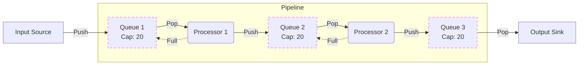

# 核心业务处理逻辑 (Core Business Logic)

> **文档控制信息 (Document Control)**
> - **文档标识 (Document ID)**: FFC-DEV-ZH-DESIGN-PIPELINE-2026
> - **当前版本 (Version)**: V1.0.0
> - **状态 (Status)**: 正式 (Official)
> - **权威性 (Authority)**: Normative
> - **所有者 (Owner)**: 王辉
> - **审核人 (Reviewer)**: 王辉
> - **最后更新 (Last Updated)**: 2026-09-28

## 修订历史记录 (Revision History)

| 版本号 | 修订日期 | 修订人 | 审核人 | 修订描述 |
| :--- | :--- | :--- | :--- | :--- |
| **V1.0.0** | 2026-09-28 | AI Agent | 王辉 | 自 [design.md](./design.md) V3.3 拆分（文档治理 P3：单文档 ≤800 行红线），内容未变更。 |

> 所属总纲：[design.md](./design.md)

---

## 4. 核心业务处理逻辑 (Core Business Logic)

### 4.1 处理器与适配器 (Processor and Adapter)

系统采用 **AI 核心与图像编排分离 (Core-Orchestration Decoupling)** 的设计原则。

*   **人脸处理器 (Processor)**: 作为 **AI 推理核心**，其职责仅限于处理 **归一化后的裁切图像 (Aligned Crop)**。
    *   **输入约束**: 仅接受符合模型规格（如 128x128）的裁切图及必要 Embedding 参数。
    *   **单一职责**: 专注于神经网络推理算法。不感知原图尺寸，不负责几何变换 (Warp/Crop) 或复杂的融合逻辑。
*   **流水线适配器 (Pipeline Adapter)**: 作为 **业务编排层**，负责维护图像的生命周期与空间变换。
    *   **几何变换**: 负责根据 Landmarker 关键点从原图中裁切 (Warp/Crop) 人脸。
    *   **后处理编排**: 调用处理器获取结果后，执行色彩匹配 (Color Matching)、遮罩处理 (Masking) 与贴回融合 (Paste back)。
    *   **并行加速**: 在适配器层利用线程池并行处理多个人脸，提高整体吞吐量。

#### 4.1.1 换脸处理器 (Face Swapper)
*   **核心功能**: 将源人脸 (Source) 特征映射至单张对齐过的目标人脸裁切图 (Target Crop)。
*   **处理流 (由 Adapter 驱动)**:
    1.  **裁切 (Adapter)**: 根据 Landmarker 计算仿射矩阵，获取对齐的 Target Crop。
    2.  **推理 (Processor)**: 将 Source Embedding 注入 Target Crop，生成 Swapped Crop。
    3.  **色彩匹配 (Adapter)**: 将 Swapped Crop 的色调转换至 Target Crop 空间。
    4.  **贴回 (Adapter)**: 应用遮罩并将处理后的人脸融合回原始全尺寸帧。

#### 4.1.2 人脸增强处理器 (Face Enhancer)
*   **核心功能**: 对单张归一化人脸裁切图进行超分辨率重建。
*   **处理流 (由 Adapter 驱动)**:
    1.  **裁切与推理**: 同上。
    2.  **融合**: 应用边缘融合 (Box/Region Blending) 并贴回。

#### 4.1.3 表情还原处理器 (Expression Restorer)
*   **核心功能**: 修正换脸后人脸裁切图的表情指标，使其贴合原始裁切图的神态。
*   **逻辑**: 处理单张裁切图序列，输出表情还原后的结果图。
*   **处理流 (由 Adapter 驱动)**: 负责维护原始帧与当前帧的裁切映射，并进行时序编排。

#### 4.1.4 全帧增强处理器 (Frame Enhancer)
*   **功能**: 对全画幅进行超分辨率处理。
*   **适用性**: 提升整体画质，处理背景与非人脸区域。
*   **Tile 分块处理策略**:
    *   **问题背景**: 高分辨率图像 (如 4K) 直接推理会导致显存溢出 (OOM)。
    *   **解决方案**: 将输入帧切分为固定大小的瓦片 (Tiles)，逐块推理后合并。
    *   **实现位置**: `src/domain/frame/enhancer/impl/frame_enhancer_impl.*`（`create_tile_frames` / `merge_tile_frames`）。
    *   **参数**: `tile_size` 与 `model_scale` 为 **FrameEnhancer 内部构造参数**（默认 `[512, 512, 32]` 与模型放大倍数），**未暴露为 TaskConfig 配置字段**；TaskConfig 仅可通过 `params.model` 选择模型（x2/x4/x8 由模型隐含决定）。
    *   **处理流程**:
        1.  **切分 (create_tile_frames)**: 按 `tile_size` 将输入帧切分为重叠瓦片。
        2.  **逐块推理**: 对每个瓦片单独进行超分辨率推理。
        3.  **合并 (merge_tile_frames)**: 通过重叠区域混合消除接缝伪影。
    *   **显存优化**: Tile 尺寸越小，峰值显存越低 (近似线性关系)，但处理时间增加。

### 4.2 流水线 (Pipeline)
*   **核心功能**: 顺序组织并串行执行多组处理器，实现复杂的多阶段图像/视频增强逻辑。
*   **架构设计**:
    *   **拓扑结构**: 采用 **线性链式 (Linear Chain)** 结构。
    *   **解耦机制**: 处理器间通过 **线程安全有界队列 (Thread-Safe Bounded Queues)** 进行物理解耦。
    *   **处理流**: 每个 Processor 节点仅负责从其 **输入队列 (Input Queue)** 消费数据，处理完成后推送到其 **输出队列 (Output Queue)**。
*   **设计优势**: 节点无需感知流水线的上下文，支持高度并发的任务流水化处理 (Pipelining)，最大化硬件吞吐量。
*   **逻辑示意**:

#### 4.2.1 流水线策略 (Pipeline Strategy)
*   **顺序模式 (Sequential)** (Default/Latency Oriented):
    *   **逻辑**: `Frame_1 -> [P1->P2->P3] -> Output`
    *   **适用**: 实时流处理，能够容纳同时加载多个模型到显存的高配机器。
    *   **优点**: 极低的首帧延迟，内存开销最小 (In-flight frames 极少)。
*   **批处理模式 (Batch)** (Throughput/VRAM Oriented):
    *   **逻辑**: `All_Frames -> P1 -> Buffer(Disk/RAM) -> P2 -> Output`
    *   **适用**: 显存受限设备 (低显存跑大模型)，或离线大批量处理。
    *   **优点**: 结合 `memory_strategy: strict` 可实现"单模型显存占用"，极大降低硬件门槛。
    *   **代价**: 需要较大的内存或磁盘空间存储中间结果 (`Frames * Resolution * Bytes`)。
---
