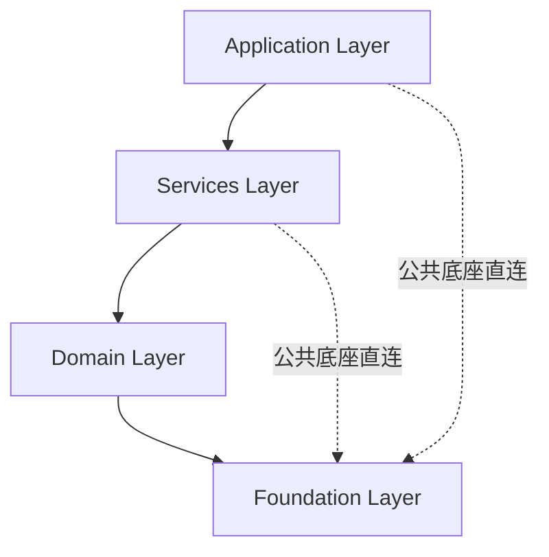

# 应用层架构设计说明书 (Application Layer Architecture Design Specification)

> **文档控制信息 (Document Control)**
> - **文档标识 (Document ID)**: FACE-FUSION-APP-ARCH
> - **当前版本 (Version)**: V4.0.0
> - **状态 (Status)**: 正式 (Official)
> - **权威性 (Authority)**: Normative
> - **所有者 (Owner)**: 王辉
> - **审核人 (Reviewer)**: 王辉
> - **最后更新 (Last Updated)**: 2026-09-28

## 修订历史记录 (Revision History)

| 版本号 | 修订日期 | 修订人 | 审核人 | 修订描述 |
| :--- | :--- | :--- | :--- | :--- |
| **V4.0.0** | 2026-09-28 | AI Agent | 王辉 | 文档治理 P3：为满足单文档 ≤800 行红线，拆分出 5 份子册（配置 / 接口 / 流水线 / 工程化 / 附录）；总纲保留设计原则、核心架构与未来规划，并新增「子文档快捷导航」。 |
| **V3.3** | 2026-08-14 | AI Agent | 王辉 | 配置体系修复 (fix/config-validation)：config_version 统一 0.34.1；§3.3.1 版本校验已实装；max_frames 标注接线；batch_buffer_mode 等标注 WIP。 |
| **V3.2** | 2026-08-14 | AI Agent | 王辉 | 依据 layers_doc_assessment.md 修正 §1.2 分层架构：5 层 → 实际 4 层。 |
| **V3.1** | 2026-08-13 | AI Agent | 王辉 | 视频分段功能已实现，segment_duration_seconds 接线至 runner_video。 |
| **V3.0** | 2026-08-13 | AI Agent | 王辉 | 依据 design_doc_assessment.md 全面修订 CLI 参数名、FlatBuffers/错误码/配置校验状态等。 |

> 仅保留最近 5 条记录，更早历史可通过 `git log --oneline docs/explanation/zh/architecture/design.md` 查阅。

---

## 📂 子文档快捷导航 (Sub-document Navigation)

| 子册 | 覆盖内容 |
| :--- | :--- |
| [design-configuration.md](./design-configuration.md) | §3.1–3.3 应用配置、任务配置、配置校验机制 + 附录 A.2 配置文件快速对照 |
| [design-interfaces.md](./design-interfaces.md) | §3.4–3.5 构建系统规范、命令行接口 + 附录 A.4 依赖项说明 |
| [design-pipeline.md](./design-pipeline.md) | §4 核心业务处理逻辑（处理器与适配器、流水线） |
| [design-engineering.md](./design-engineering.md) | §5 工程化约束与最佳实践（错误处理、优雅停机、并发流控、日志与 Metrics） |
| [design-appendix.md](./design-appendix.md) | 附录 A.3 标准测试素材、A.5 数据格式选型 |

---

## 1. 引言 (Introduction)

### 1.1 目的 (Purpose)
本文档旨在规范 **FaceFusionCpp** 项目应用层 (Application Layer) 的架构设计、配置管理规范及核心业务流程。作为应用层开发的最高指导原则，本文档明确了静态环境与动态作业的边界，规定了工程化实现的约束条件，以确保系统的高可用性、可维护性及扩展性。

### 1.2 架构原则 (Architecture Principles)
本设计严格遵循项目定义的 **4层分层架构 (4-Layered Architecture)**：

*   **依赖单向性 (Unidirectional Dependency)**: 上层仅依赖下层，严禁反向依赖或跨层跳跃调用。Foundation 作为公共底座，允许任何上层直接依赖（实现细节见 [layers.md](layers.md)）。
*   **模块化 (Modularity)**: 基于 **C++20 Modules** (`.ixx` / `.cppm`) 构建，强制物理隔离接口与实现，子系统间仅通过明确定义的接口交互。

---

## 2. 核心架构设计 (Core Architecture Design)

### 2.1 关注点分离 (Separation of Concerns)
为实现系统配置的高内聚低耦合，将配置域严格划分为 **静态环境基础设施** 与 **动态业务流水线**。

| 维度         | **App Config (应用配置)**                      | **Task Config (任务配置)**                      |
| :----------- | :--------------------------------------------- | :---------------------------------------------- |
| **定位**     | 运行时环境与基础设施定义                       | 具体业务处理逻辑定义                            |
| **引用**     | [3.1 应用配置](design-configuration.md#31-应用配置-app-configuration) | [3.2 任务配置](design-configuration.md#32-任务配置-task-configuration) |
| **生命周期** | 进程级 (Global Static)                         | 任务级 (Task-Scoped Dynamic)                    |
| **可变性**   | 启动时加载，运行时不可变                       | 每次任务执行时动态加载                          |
| **典型内容** | 日志级别、模型仓库路径、硬件资源限额           | Pipeline 步骤拓扑、输入输出路径、算法参数       |

### 2.2 运行模式 (Execution Modes)
系统设计支持多种运行模式，底层核心逻辑（`RunPipeline` 接口）保持一致，仅在接入层（Access Layer）有所区分。

*   **命令行接口 (CLI Mode)** (Current Focus)
    *   通过命令行参数 (`-c/--task-config`) 注入任务配置。
    *   适用于离线批处理、CICD 脚本自动化场景。
*   **服务化接口 (Server Mode)** (Future Roadmap)
    *   通过 HTTP/RPC 接收动态配置负载。
    *   适用于即时推理服务、Web 后端集成场景。
    *   **设计约束**: CLI 与 Server 模式除 "配置加载器" 与 "进度回调" 外，必须完全复用底层业务逻辑。

---

## 6. 未来规划 (Future Roadmap)

### 6.1 自动化配置校验 (Config Validation)
*   **当前状态**: ✅ **已实现**。配置校验已完整实装（`src/app/config/config_validator.ixx`），支持启动时校验、任务提交时校验及 CLI `--validate` 离线校验，错误报告含 YAML Path 定位。
*   **未来目标**: 引入 JSON Schema 进行声明式校验，支持配置迁移工具。

### 6.2 插件化处理器架构 (Plugin Architecture)
*   **目标**: 支持第三方开发者扩展 Processor 而无需修改核心代码。
*   **方案**: 定义稳定的 C++ ABI 接口，支持动态加载 (`.dll`/`.so`) 外部实现的 Processor。

### 6.3 服务化接口 (Server Mode)
*   **目标**: 支持 HTTP/RPC 远程调用。
*   **方案**: 复用现有 Pipeline 逻辑，通过 Websocket 推送进度，通过 REST API 接收任务。

---

### A.1 术语表 (Glossary)

| 术语                | 定义                                                                |
| :------------------ | :------------------------------------------------------------------ |
| **Pipeline**        | 由多个 Processor 串联组成的处理链，按顺序对帧数据进行加工           |
| **Processor**       | 单一功能的处理单元 (如 FaceSwapper, FaceEnhancer)，遵循统一接口规范 |
| **Backpressure**    | 当下游处理速度慢于上游时，通过队列满阻塞上游的流控机制              |
| **Pass-through**    | 透传：当检测失败或无需处理时，原样传递数据而不做任何修改            |
| **LRU Cache**       | 最近最少使用缓存，用于管理模型加载/卸载策略                         |
| **Checkpoint**      | 断点文件，记录任务执行进度以支持中断恢复                            |
| **FACEFUSION_HOME** | 系统根目录环境变量，所有相对路径的基准                              |
